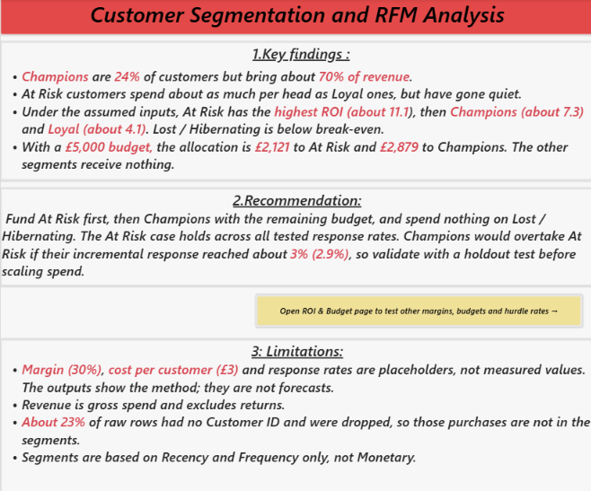
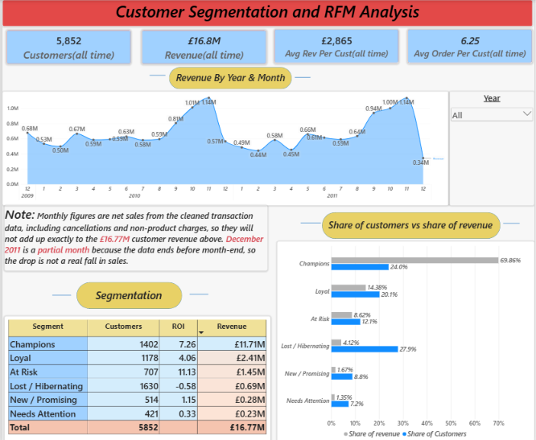
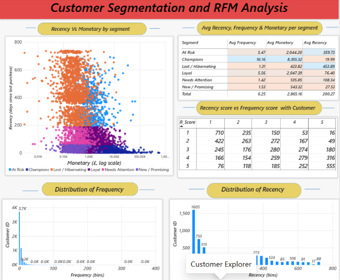
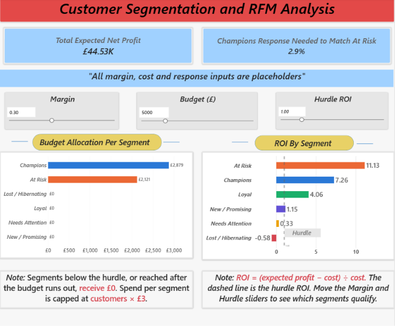
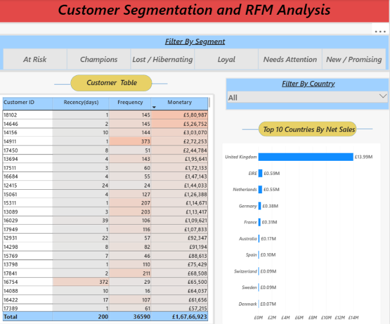

# Customer Segmentation (RFM) and Retention Campaign ROI

**Which customer segment will give the highest ROI on a retention campaign, and how should the marketing team allocate budget?**

An end-to-end analysis of the UCI *Online Retail II* dataset: data cleaning, RFM scoring, customer segmentation, a retention-campaign ROI model, a budget allocation rule, and an interactive Power BI dashboard.

> **Important:** the margin (30%), campaign cost (£3 per customer) and incremental response rates are **placeholder assumptions**, not measured values. The outputs demonstrate the method. They are not forecasts.

## Dashboard preview

**Summary**


**Overview**


**RFM Behavior**


**ROI & Budget**


**Customer Explorer**


---

## Key findings

| Segment | Notes | ROI (default assumptions) |
|---|---|---|
| At Risk | Spend about as much per head as Loyal customers, but have gone quiet | ~11.1 |
| Champions | 24% of customers, about 70% of revenue | ~7.3 |
| Loyal | | ~4.1 |
| Lost / Hibernating | Below break-even | negative |

- With a **£5,000 budget** and a hurdle ROI of 1.0, the allocation is **£2,121 to At Risk** and **£2,879 to Champions**. All other segments receive nothing.
- **Recommendation:** fund At Risk first, then Champions with the remainder, and spend nothing on Lost / Hibernating.
- Champions would overtake At Risk if their incremental response reached about **3% (2.9%)**. Validate with a holdout test before scaling spend.

---

## Project structure

```
Project_4_Customer_Segmentation_RFM/
├── Dashboard/
│   └── Customer_Segmentation_and_RFM_analysis.pbix   # Power BI report
├── data/
│   ├── online_retail_II.csv              # raw data (download, not committed)
│   ├── cleaned_online_retail_II.csv      # cleaned transactions
│   ├── cancellations_online_retail_II.csv# cancelled invoices, kept separate
│   ├── rfm_base_online_retail_II.csv     # Recency, Frequency, Monetary per customer
│   ├── rfm_online_retail_II.csv          # RFM scores and segments
│   ├── segmentation_online_retail_II.csv # segment summary with ROI inputs
│   ├── assumptions_online_retail_II.csv  # margin, cost, response rates
│   └── budget_allocation_online_retail_II.csv  # allocation at default settings
├── Notebook/
│   └── EDA.ipynb                         # cleaning, RFM, segmentation, ROI, allocation
├── Images/                               # dashboard screenshots used in this README
├── requirements.txt
├── .gitignore                            # excludes venv/ and the raw CSV
└── README.md
```

---

## Method

1. **Cleaning**: remove rows without a Customer ID (about 23% of raw rows), separate cancellations and non-product charges, compute `TotalPrice = Quantity × Price`.
2. **RFM metrics** per customer:
   - Recency: days since last purchase
   - Frequency: number of invoices
   - Monetary: total net product spend
3. **Scoring**: R and F scored 1 to 5 by quantile. Segments are assigned from R and F scores only (Monetary is not used).
4. **ROI model**, per segment:
   - `Expected profit = Customers × Incremental response × Avg annual value × Margin`
   - `Cost = Customers × Cost per customer`
   - `ROI = (Expected profit − Cost) ÷ Cost`
5. **Budget allocation**: rank segments by ROI, keep those above the hurdle ROI, fund the highest first. Each segment is capped at its full campaign cost and at the remaining budget.
6. **Sensitivity**: response-rate sweeps for Champions and At Risk. The At Risk result holds across all tested rates (ROI above 2 even at 3% response).

### Placeholder assumptions

| Input | Default |
|---|---|
| Margin | 30% |
| Cost per customer | £3 |
| Budget | £5,000 |
| Hurdle ROI | 1.0 |
| Incremental response | Champions 2%, Loyal 5%, At Risk 12%, Lost 2%, New / Promising 8%, Needs Attention 5% |

---

## Power BI dashboard

| Page | What it shows |
|---|---|
| Summary | Key findings, recommendation, limitations, and a link to the sliders |
| Overview | Customers, revenue, monthly net sales, share of customers vs share of revenue, segment table |
| RFM Behavior | Average R, F, M per segment, Recency vs Monetary scatter (log axis), distributions, R × F heatmap |
| ROI & Budget | Sliders for margin, budget and hurdle ROI; live ROI by segment, budget allocation, total expected net profit, Champions break-even response |
| Customer Explorer | Customer table filtered by segment and country, top 10 countries by net sales |

**Model:** `Segmentation 1→* Customers 1→* Sales`, with a `Calendar` table related to `Sales`. The sliders are What-if parameters. Measures: `Expected Profit`, `Campaign Cost`, `ROI Live`, `Budget Spend`, `Total Expected Net Profit`, `Champions Breakeven Response`.

**Open the report:** use Power BI Desktop. On the Summary page, Ctrl + click the button to jump to the ROI & Budget page.

---

## Data

- Source: [Online Retail II](https://archive.ics.uci.edu/dataset/502/online+retail+ii), transactions from a UK online retailer, Dec 2009 to Dec 2011.
- Currency: GBP (£).
- "Revenue" in the cards is net product spend per customer (£16.77M). Monthly and country charts use transaction `TotalPrice`, which includes cancellations and non-product charges, so they are labelled **Net Sales** and will not sum to the customer revenue figure.
- The raw dataset is not committed (see `.gitignore`). Download it and place it in `data/`.

## Limitations

- Margin, cost per customer and response rates are placeholders.
- Revenue is gross spend and excludes returns.
- About 23% of raw rows had no Customer ID and were dropped, so those purchases are not in the segments.
- Segments use Recency and Frequency only.
- December 2011 is a partial month, so the final drop in monthly sales is not a real decline.

## How to run

1. Clone the repository and create a virtual environment:
   ```
   python -m venv venv
   venv\Scripts\activate        # Windows
   source venv/bin/activate        # macOS / Linux
   pip install -r requirements.txt
   ```
2. Download `online_retail_II.csv` (link above) and place it in `data/`.
3. Open `Notebook/EDA.ipynb` and run all cells. It writes the processed CSVs to `data/`.
4. Open `Dashboard/Customer_Segmentation_and_RFM_analysis.pbix` in Power BI Desktop. If prompted, point the data sources to the CSVs in `data/`.

## Author

**Harshit Tiwari**,Gorakhpur, India.
